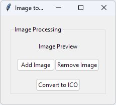
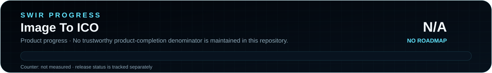

<!-- SWIR-README-STANDARD:v2 -->

<div align="center">


# Image To ICO

**Preview PNG/JPEG images and export verified, multi-resolution Windows icons.**


[**Download**](https://github.com/Swir/Image-To-Ico/releases/latest) · [**Usage**](#usage) · [**Changes**](CHANGELOG.md) · [**Verification**](#verification)

</div>

## Screenshot — earlier interface



The earlier 1.0 interface on Windows. Version 1.1 adds a file list, icon-size selection, progress, cancellation and per-file results.

## Project status

| Item | Current state |
|---|---|
| Source | **1.1.0** |
| Windows download | [Latest verified release](https://github.com/Swir/Image-To-Ico/releases/latest) |
| Supported input | PNG, JPG and JPEG, up to 40 megapixels per image |
| Export | One multi-resolution ICO per source image |
| Embedded sizes | 16, 24, 32, 48, 64, 128 and 256 pixels |
| Verification | Regression suite plus source and frozen Windows runtime smoke tests |
| Product roadmap | No authoritative product-completion denominator; progress remains N/A |

<p align="center">
  
</p>

Source version, release availability and product-roadmap progress are separate. The release workflow publishes only after regression, packaged-runtime, checksum and fresh-download checks pass.

## Overview

Image To ICO converts local PNG/JPEG files into Windows `.ico` files. Each source image becomes one icon containing the selected resolutions. Pillow handles decoding, preview and ICO export; imageio is no longer required.

Images retain their aspect ratio and receive transparent padding to fit a square icon canvas. Existing alpha transparency and JPEG EXIF orientation are preserved. The app does not upload images or contact a conversion service.

## Highlights

| Feature | Behavior |
|---|---|
| File list and preview | Select and preview an input; remove the selected item. |
| Embedded icon sizes | Choose any supported combination of sizes in each ICO. |
| Single-image export | Choose an ICO path; the save dialog asks before replacing an existing file. |
| Batch export | Choose a folder; export one ICO per input and add numbered suffixes to avoid existing filenames. |
| Verified writing | Reopen every embedded size before finalizing the output. |
| Atomic replacement | A failed conversion does not replace an existing destination file. |
| Responsive processing | Conversion runs off the GUI thread; cancellation stops before the next image. |
| Per-file results | See successful output paths and individual failures; a corrupt batch input does not stop valid later inputs. |

## Quick Start

### Windows package

Download the [latest verified release](https://github.com/Swir/Image-To-Ico/releases/latest). Choose `Image-To-Ico.exe` or extract the portable Windows x64 ZIP and launch the EXE inside it. Python is included.

New releases include `SHA256SUMS.txt`, `BUILD_INFO.json` and `runtime-verification.json`. Compare a downloaded file with its entry in the checksum manifest:

```powershell
Get-FileHash .\Image-To-Ico-v1.1.0-Windows-x64.zip -Algorithm SHA256
Get-Content .\SHA256SUMS.txt
```

### From source

Use Python with Tkinter support:

```powershell
git clone https://github.com/Swir/Image-To-Ico.git
cd Image-To-Ico
python -m venv .venv
.\.venv\Scripts\python.exe -m pip install -r requirements.txt
.\.venv\Scripts\python.exe ikona.py
```

`requirements.txt` is a valid pinned dependency list. Tkinter comes from the Python/OS installation, not from PyPI. The Windows release workflow uses Python 3.12; no packaged Linux or macOS release is claimed.

## Usage

1. Choose **Add PNG / JPEG…** and select one or more images.
2. Select a file to see its preview. **Remove selected** removes only that entry from the list, not the original file.
3. Choose the resolutions to embed in each icon.
4. Choose **Convert to ICO…**. For one image, choose a filename; for several images, choose a folder.
5. Review the output paths and any errors in the results area.

Batch names such as `photo.ico`, `photo (2).ico` and `photo (3).ico` preserve existing files and handle identical basenames from different input folders. **Cancel batch** stops before the next image. Closing during conversion waits for the current image to finish before exiting.

## Verification

```powershell
python -m unittest discover -s tests -v
python ikona.py --self-test ico-self-test.json
```

The regression suite covers all seven ICO sizes, PNG alpha, palette transparency, JPEG orientation, proportional padding, corrupt inputs, batch name collisions, cancellation and preservation of existing files after export failures.

The self-test creates a hidden application window, renders a real image preview, exports generated PNG/JPEG fixtures through the background conversion flow and reopens both ICO outputs. It uses an isolated temporary folder and does not touch user images, the clipboard or the pointer.

Release verification repeats this test in the standalone EXE and the extracted portable package. The workflow then downloads its draft release, verifies checksums and source provenance, repeats the frozen-runtime test and publishes the release. Existing public releases are never overwritten.

The old imageio multi-image failure is retained as historical evidence in [the 2026-09-17 verification notes](docs/README-VERIFICATION.md); it describes the earlier source, not the 1.1 implementation.

## Project layout

| Path | Purpose |
|---|---|
| `ikona.py` | Tkinter UI, preview, background worker and runtime smoke test |
| `ico_core.py` | Image validation, proportional canvas, ICO writing and batch naming |
| `tests/test_conversion.py` | File-based conversion regressions |
| `requirements.txt` | Runtime dependency |
| `scripts/release_tools.py` | Build, package, checksum and release verification |
| `.github/workflows/release.yml` | Windows build and gated publication |
| `CHANGELOG.md` | Version history |

## Known limitations

- PNG and JPEG are the supported input formats; animated icons and pixel editing are outside this utility's scope.
- Inputs are limited to 40 megapixels. Very small images can look soft when enlarged to larger icon sizes.
- Icons use transparent square padding; cropping and manual positioning are not provided.
- Cancellation takes effect between images, allowing the current output to finish safely.
- No authoritative product-wide roadmap is maintained, so the progress graphic remains N/A.

## License and attribution

Developed by **Swir**. No `LICENSE` file is currently included; this update does not assign new licensing terms.

<div align="center">


### `SELECT • PREVIEW • EXPORT`

[**SWIR profile**](https://github.com/Swir) · [**Releases**](https://github.com/Swir/Image-To-Ico/releases) · [**Report an issue**](https://github.com/Swir/Image-To-Ico/issues)

</div>
